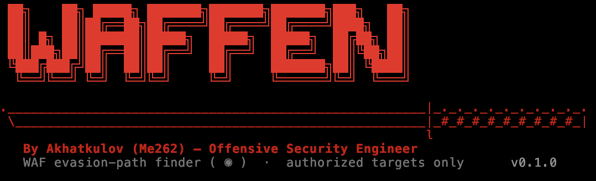

<p align="center">
  
</p>

**WAF evaluation & bypass-research toolkit — for targets you own or are explicitly authorized to test.**

WAFFEN searches for *evasion paths* against a Web Application Firewall: given an
attack payload the WAF blocks, it discovers a chain of mutations (encodings,
obfuscations, request-level transforms) that still reaches the origin — so the
coverage gap can be found and fixed. It is built by and for the RedEye WAF team
as a red-team / regression instrument, in the same family as
[GoTestWAF](https://github.com/wallarm/gotestwaf), [wafw00f](https://github.com/EnableSecurity/wafw00f),
and WAFNinja.

> ⚠️ **Authorized use only.** WAFFEN sends attack-shaped traffic. Point it only at
> systems you own or have written permission to test. The default configuration
> targets the project's own RedEye demo. You are responsible for how you use it.

---

## Why WAFFEN is different

Existing tools split into **recon** (wafw00f fingerprints the WAF) and **evasion**
(WAFNinja/WhatWaf fuzz payloads). GoTestWAF measures coverage as a cartesian
product of `payload × encoder × placeholder`. WAFFEN adds the missing piece:

**A feedback-driven search for an evasion *path*, not a blind payload dump.**

It treats bypass discovery as a bounded search problem. A blocked payload is a
start state; mutators are the operators; a THROUGH response is the goal. Because
block/through feedback is binary and sparse, WAFFEN ranks the still-blocked
frontier by how much each mutation *perturbs* the stack (status-code / body-size
drift from the baseline block) and expands the most promising branches — a
beam search that converges on a working chain within a request budget.

Found chains feed a versioned **knowledge base** that updates over time (roadmap),
so the tool gets smarter about a given WAF the more it is run.

---

## Install

```bash
cd WAFFEN
pip install -e .          # or: pipx install .
waffen version
```
v1 core is **stdlib-only** (requests go through `curl`), so it also runs straight
from a checkout: `python3 -m waffen ...`.

## Usage

```bash
# list the 120+ mutators and the request-level transforms
waffen mutators
waffen mutators --class "SQL Injection"   # only class-valid mutators
waffen transforms

# identify the WAF in front of a target
waffen fingerprint --target https://juice-shop.redeyes.uz

# score WAF coverage + false-positive rate over a payload corpus (GoTestWAF-style)
waffen eval --target https://juice-shop.redeyes.uz --all-classes \
  --corpus ../redeyes/payloads/PayloadsAllTheThings --benign benign.txt \
  --calibrate --inject query --path /rest/products/search \
  --out coverage.json --html coverage.html

# offline engine test against a built-in mock WAF (no network, no target)
waffen bypass --mock --all-classes --stop-on-first

# genetic search + verify, sweeping request transforms, against your own WAF
waffen bypass --target https://juice-shop.redeyes.uz \
  --class "XSS Injection" --inject query --path /rest/products/search --param q \
  --strategy genetic --transforms identity,hpp_split,chunked_body \
  --verify --max-requests 400 --out findings.jsonl

# one explicit payload, body injection, beam search
waffen bypass --target https://your-waf.example \
  --payload "' OR 1=1-- -" --class "SQL Injection" --inject body --method POST

# real multipart file-upload test — dangerous extensions, not query strings
waffen bypass --target https://your-waf.example --inject upload --param file \
  --path /file-upload --method POST --class "Upload Insecure Files" \
  --strategy bestfirst --rules

# long sequential run: ban-detector + WAF-rule output for anything confirmed
waffen bypass --target https://your-waf.example --class "XSS Injection" \
  --canary "harmless-probe-value" --canary-every 25 --verify --rules-out rules.md

# measure the real body-inspection cutoff instead of guessing (nowafpls++)
waffen eval --target https://your-waf.example --all-classes --find-cutoff

# check/apply a KB update (no default source yet — point it at one explicitly)
waffen kb-update --name my-kb --kind manifest --manifest-url https://example.com/kb.json
```

Key flags: `--strategy {beam,genetic,bestfirst,mcts}`, `--transforms` (request-shape
axis to sweep; `structural`/`placeholder_extra` select whole groups), `--calibrate`
(learn the WAF's block/pass signature at runtime instead of assuming 403=blocked),
`--verify` (inline **verified search**: confirm each bypass is still exploitable,
and keep hunting past dead ones rather than stopping on a payload that passed the
WAF but no longer executes), `--inject {query,path,rawpath,body,json,header,cookie,
upload}` (`upload` sends a real multipart file, payload controls the filename/
extension), `--concurrency` (batch-evaluate via `send_many`; beam/genetic/bestfirst
speed up, MCTS is sequential by nature), `--canary`/`--canary-every` (ban-onset
detector: re-probes a known-benign value, since a rate-limit ban usually looks like
a clean fast 403, not a timeout), `--rules`/`--rules-out` (suggested WAF rule per
finding/gap, Markdown or console), `--find-cutoff` (live binary-search of the body-
inspection cutoff), `--width`/`--depth` (beam), `--pop-size`/`--generations`
(genetic), `--max-requests` (budget per run), `--stop-on-first`, `--all-mutators`,
`--block-signature`, `--verbose`.

---

## Architecture

```
waffen/
  engine.py             — orchestrator: sweep request-transform × seed × strategy (+verify)
  core/     oracle.py   — curl sender, BLOCKED/THROUGH/DOWN classifier, score(), send_many(),
                          upload-filename inject mode, ban-onset canary detector
            transforms.py — request-level transforms (HPP, chunked, multipart, verb, GraphQL,
                          structural/parser-differential, nowafpls-style padding + live cutoff search)
            mock.py     — offline signature-WAF simulator for tests
            rawhttp.py / smuggle.py — raw-socket transport + CL.TE/TE.CL desync probes
  mutate/   base.py     — Mutator + Registry (per-class operator selection)
            encoders.py / obfuscators.py / sql_tamper.py / xss_context.py /
            path_cmd.py / generic_extra.py / quickwin.py / advanced.py — 160+ class-aware mutators
  search/   beam.py / genetic.py / bestfirst.py / mcts.py — 4 guided search strategies, each
                          with optional `concurrency` (batched via oracle.send_many)
            bandit.py   — UCB1 operator-selection + blocked-pattern memory
            scoring.py  — composite fitness (chain-length penalty, 4xx→5xx bonus)
  verify/   verifier.py — per-class semantic check: is a THROUGH payload still exploitable?
            calibrate.py — learn the WAF's block/pass signature at runtime (ffuf -ac style)
            structural.py — WAFFLED 3-part oracle for parser-differential bypasses
  recon/    fingerprint.py — wafw00f-style WAF ID (9 vendors) + test-plan/body-limit hints
            normalize.py — GOFA-lite: probe which encodings the WAF's normalizer misses
  eval/     coverage.py — GoTestWAF-style coverage + false-positive scoring over a corpus
            corpus.py   — harvest payloads from a PayloadsAllTheThings-style tree
            dataset.py  — labelled attack+benign training-set export
  kb/       seeds.py    — built-in seed payloads per attack class (bootstrap)
            update.py   — nuclei-style versioned KB auto-update (pluggable, no default source yet)
  report/   results.py  — console/JSONL findings summary
            html.py     — standalone styled HTML coverage report
            rules.py    — WAF-rule recommendation generator (finding/gap → actionable rule text)
  cli.py                — `waffen bypass | eval | dataset | smuggle | fingerprint | kb-update |
                          mutators | transforms | version`
```

### Two orthogonal evasion axes
- **Payload mutation** (`mutate/`): rewrite the string — 120+ encoders/obfuscators,
  each tagged with the attack classes it stays valid for, composed into chains.
- **Request transforms** (`core/transforms.py`): rewrite the whole HTTP request —
  HPP, chunked/multipart framing, content-type confusion, verb tampering, plus a
  **structural / parser-differential set** (`--transforms structural`): WAFFLED-style
  JSON/multipart/XML envelope distortions (duplicate/unicode keys, multipart
  disposition & boundary tricks) that make the WAF misparse the body while the
  backend still extracts the payload — a bypass class needing no payload encoding.
  Swept independently of payload mutation, so `engine.py` explores their product.

### The search loop (`search/beam.py`)
1. Send the seed. If already THROUGH → report a raw gap, done.
2. Otherwise expand the frontier: apply every class-valid mutator to each state,
   send each result, collect any THROUGH as a **finding**.
3. Rank the still-blocked candidates by `oracle.score()` (code/size drift from the
   baseline block) and keep the top-`width`.
4. Repeat to `depth` or until the request budget runs out.

The oracle decouples transport from search, so the same engine runs against a
live WAF (`curl`) or the offline mock (unit tests), and future senders (httpx,
raw sockets for HTTP-smuggling transforms) plug in without touching the search.

---

## Roadmap

- **v1 (done): bypass-search engine** — 120+ mutators, beam + genetic search,
  request-level transforms, semantic verifier, WAF fingerprint, orchestrator, 37 tests.
- **v1.2 (next): eval + reporting** — GoTestWAF-style coverage/FP scoring (ports the
  existing `corpus_runner`), HTML report, parallel search via `oracle.send_many`.
- **v1.3: knowledge base + auto-update** — versioned KB of payloads/mutators/known
  evasions, `waffen kb update` pulling a signed release (nuclei-templates model),
  with found chains promoted back into the KB.
- **v1.4: training export** — labelled dataset export (ports `make_dataset`) to
  train the RedEye WAF on discovered evasions + benign traffic.

## Prior art & credits

[GoTestWAF](https://github.com/wallarm/gotestwaf) (payload×encoder×placeholder model),
[wafw00f](https://github.com/EnableSecurity/wafw00f) (fingerprinting),
[PayloadsAllTheThings](https://github.com/swisskyrepo/PayloadsAllTheThings) (payload corpus),
[nuclei-templates](https://github.com/projectdiscovery/nuclei-templates) (auto-update model),
and the [awesome-waf](https://github.com/0xInfection/Awesome-WAF) collection.

## License
MIT.
