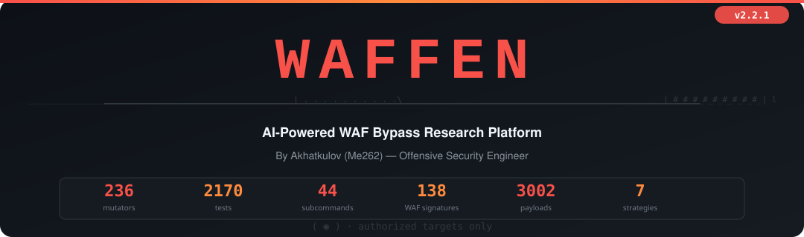

<p align="center">
  
</p>

<p align="center">
  <b>The most comprehensive open-source WAF bypass research platform.</b><br>
  <sub>236 mutators · 26 transforms · 7 search strategies · 138 WAF signatures · 3002 payloads · 2170 tests</sub>
</p>

<p align="center">
  <a href="https://github.com/akhatkulov/WAFFEN/releases"></a>
  <a href="#license"></a>
  <a href="#quick-start"></a>
</p>

---

WAFFEN discovers *evasion paths* against Web Application Firewalls. Given an
attack payload the WAF blocks, it uses AI-powered search (beam / genetic / DNA /
best-first / MCTS / adaptive / **reinforcement learning**) over 236 mutators × 26
request transforms to find a mutation chain that bypasses detection — then
**exploits** through the bypass and generates **defensive rules** to fix the gap.

Built by the [RedEye WAF](https://redeyes.uz) team as a red-team / regression /
research instrument.

> ⚠️ **Authorized use only.** WAFFEN sends attack-shaped traffic. Point it only at
> systems you own or have written permission to test.

---

## Quick Start

```bash
git clone https://github.com/akhatkulov/WAFFEN.git
cd WAFFEN
python3 -m venv .venv && .venv/bin/pip install -e .
waffen auto                                           # guided wizard
waffen redteam --target https://your-waf.example      # fully autonomous
```

```bash
# Or Docker:
docker run --rm akhatkulov/waffen auto --url https://your-waf.example -y
```

---

## Numbers

| Metric | Count |
|--------|-------|
| Mutators | **236** (SQL-AST, semantic, grammar, SSTI/SSRF/XXE, DNA genetics) |
| Request transforms | **26** (HTTP, multipart, JSON, GraphQL, brotli, H2) |
| Search strategies | **7** (beam, genetic, DNA, best-first, MCTS, adaptive, **RL**) |
| WAF fingerprint signatures | **138** (cloud, on-prem, CDN, regional) |
| CRS rule signatures | **86** (PL1-PL4, 11 categories) |
| Payload corpus | **3002** across 16 attack classes |
| DBMS exploiters | **4** (SQLite, MySQL, PostgreSQL, MSSQL) |
| SQL grammars | **3** (SQL, XSS, SSTI context-free grammars) |
| Report formats | **6** (JSONL, HTML, SARIF, CSV, Nuclei, WAF rules) |
| Tests | **2170** |
| Subcommands | **44** |
| Known bugs | **0** |

---

## All 44 Subcommands

### Search & Fuzzing

| Command | Description |
|---------|-------------|
| `bypass` | Guided search for WAF evasion chains (7 strategies incl. RL + DNA genetics) |
| `adaptive` | Multi-stage pipeline: learn → score-probe → gap-scan → search → deepen |
| `fuzz` | High-speed wordlist fuzzing (threaded keep-alive, 500+ req/s, ffuf-style filters) |
| `redteam` | **Fully autonomous** 6-phase red team: recon→profile→plan→bypass→exploit→report |

### Reconnaissance

| Command | Description |
|---------|-------------|
| `fingerprint` | Identify the WAF (138 signatures: Cloudflare, AWS, Imperva, ModSecurity, etc.) |
| `score-probe` | Map WAF scoring-engine detection thresholds and boundary payloads |
| `libinjection-scan` | Probe for database-specific token blind spots (110+ tokens: SQLite/PG/MySQL/MSSQL) |
| `cve-probe` | Behavioural triage for 2026 WAF engine CVE primitives |
| `discover` | Auto-discover WAF-inspected injection points (params, JSON keys, headers, cookies) |
| `origin` | Find the origin server IP behind a WAF (DNS, MX, SPF, header leaks) |
| `diff` | Differential testing: WAF vs origin, or multi-WAF comparison (SPLIT detection) |
| `calibrate` | Learn block/pass signature; `--cluster` discovers response taxonomy via k-means |
| `sidechannel` | Side-channel timing oracle — extract WAF scoring from response timing |
| `rulemap` | Reverse-engineer WAF rule set (86 CRS rules, PL1-PL4 detection) |
| `dtree` | Decision tree fingerprint — map WAF processing pipeline (decode→normalize→match) |
| `adversarial` | Adversarial ML — probe ML-WAF classifier decision boundaries |

### Attack Modules

| Command | Description |
|---------|-------------|
| `graphql` | GraphQL attacks: introspection bypass, batch, alias flood, directive injection |
| `ws` | WebSocket attacks: text/binary/fragmented frame injection |
| `sequence` | Multi-request attack sequences (auth→inject, store→trigger, fragment) |
| `oob` | Built-in OOB callback server for blind SSRF/XSS/XXE/RCE verification |
| `exploit` | SQLi exploitation — UNION/blind/time/error extraction through WAF bypass |
| `plan` | Attack graph planner — Dijkstra shortest path to goals (dump_db, admin, rce) |

### Workflow

| Command | Description |
|---------|-------------|
| `auto` | Guided wizard — full pipeline with interactive prompts |
| `watch` | Re-test saved findings over time, track bypass survival |
| `minimize` | Reduce mutation chain to minimal form (chain + binary text trim) |
| `profile` | Save/resume target profiles across sessions |
| `daemon` | Continuous autonomous monitoring — periodic scans + Slack/webhook alerts |

### Defense & Intelligence

| Command | Description |
|---------|-------------|
| `defend` | Generate WAF rules from bypasses (ModSecurity, NAXSI, Cloudflare, AWS WAF) |
| `synthesize-config` | Generate optimal complete WAF configuration from findings |
| `report` | Professional HTML report (executive summary, findings, remediation) |
| `benchmark` | WAF benchmark scoring: A+ to F grade, per-class detection, FP rate |
| `grammar` | Generate payloads from SQL/XSS/SSTI context-free grammars |
| `semantic` | Semantic equivalence — 50+ provably-equivalent SQL forms |
| `synthesize` | LLM-guided payload synthesis (Claude/GPT generates context-aware bypasses) |
| `eval` | Score WAF coverage + false-positive rate over a corpus |

### Analysis & Data

| Command | Description |
|---------|-------------|
| `dataset` | Build a labelled attack+benign training set for WAF ML |
| `analyze` | Analyze a collected log offline (coverage, FP rate, HTML report) |
| `corpus` | Show the built-in 3002-payload corpus stats |
| `smuggle` | Experimental HTTP request-smuggling (CL.TE/TE.CL) probes |

### Utility

| Command | Description |
|---------|-------------|
| `mutators` | List the 236 built-in mutators (filterable by `--class`) |
| `transforms` | List the 26 request-level transforms |
| `kb-update` | Check/apply knowledge-base updates |
| `plugin` | Manage community plugins (~/.waffen/plugins/) |
| `version` | Print version |

---

## Usage Examples

```bash
# Fully autonomous red team (one command, full assessment)
waffen redteam --target https://your-waf.example --budget 5000

# Guided wizard (easiest way to start)
waffen auto --target https://your-waf.example --path /search

# Smart bypass with RL agent (learns the WAF)
waffen bypass --target URL --class sqli --strategy rl --max-requests 1000 \
  --save-policy waf-policy.json

# DNA genetics search (structured genome crossover)
waffen bypass --target URL --class sqli --strategy dna --verify --exploit-guided

# Adversarial ML — find the ML classifier's decision boundary
waffen adversarial --target URL --class sqli --budget 500

# High-speed fuzz with 3002 payloads
waffen fuzz --target URL --param q --corpus sqli -c 50 -mc 200

# Map WAF processing pipeline
waffen dtree --target URL --param q

# Reverse-engineer WAF rule set
waffen rulemap --target URL --param q

# WAF benchmark (A+ to F grade)
waffen benchmark --target URL --html benchmark.html

# Find origin server behind WAF
waffen origin --domain your-waf.example --verify

# Multi-WAF differential testing
waffen diff --targets "CRS=http://crs-lab,CloudFlare=https://cf-test" --corpus sqli

# Exploit through a WAF bypass
waffen exploit --target URL --bypass-payload "' GLOB '*" --tables --dump

# Generate optimal WAF config from findings
waffen synthesize-config --findings results.jsonl --engine modsecurity --out waf-config/

# GitHub Actions CI gate (SARIF → Security tab)
waffen bypass --target $STAGING_URL --class sqli --calibrate --verify --sarif results.sarif

# 24/7 daemon with Slack alerts
waffen daemon --target URL --interval 6 --webhook https://hooks.slack.com/XXX

# Use as Python library
python3 -c "from waffen import bypass; r = bypass('https://target.com'); print(r)"
```

---

## Common Flags

| Flag | Default | Meaning |
|------|---------|---------|
| `--target URL` | — | base URL (also `--url` on auto, `--domain` on origin) |
| `--path PATH` | `/` | request path |
| `--param NAME` | `q` | injection parameter |
| `--block-signature TEXT` | `""` | WAF block page signature (auto-detected via `--calibrate`) |
| `--transport MODE` | `auto` | `auto` / `curl` / `pooled` / `h2` |
| `--header` / `-H` | — | extra header (repeatable) |
| `--cookie` | — | cookie string for session auth |

---

## Docker

```bash
docker run --rm akhatkulov/waffen auto --url https://target.com -y
docker run --rm akhatkulov/waffen redteam --target URL --budget 5000
docker run --rm -v $(pwd)/results:/results akhatkulov/waffen bypass \
  --target URL --class sqli --out /results/findings.jsonl
docker build -t waffen .
```

## Performance

| Mode | Throughput | Use case |
|------|-----------|----------|
| `waffen fuzz` (thread pool) | 500–1000 req/s | Bulk testing |
| `waffen bypass --concurrency 10` | 200–500 req/s | Parallel search |
| `waffen bypass` (sequential) | 50–200 req/s | Precise search |

Response caching (LRU 256), keep-alive pooling, `--dry-run` for estimates.

## Lab Setup

```bash
docker compose -p waffen-lab up -d        # CRS lab on localhost:18080
waffen bypass --target http://localhost:18080 --class sqli --calibrate --verify
```

Paranoia levels 1–4 via `PARANOIA=N`. See `docs/VALIDATION.md`.

---

## Unique Capabilities (No Other Tool Has)

1. **RL bypass agent** — Q-learning that develops WAF-specific bypass policies
2. **SQL-AST token-level mutation** — 10 strategies + composite combinator
3. **Semantic equivalence engine** — 50+ provably-equivalent SQL transformations
4. **Attack graph planner** — Dijkstra multi-step automated attack chains
5. **Adversarial ML** — target ML-WAF classifier decision boundaries
6. **WAF decision tree fingerprinting** — map processing pipeline order
7. **WAF rule reverse engineering** — reconstruct rule set from black-box
8. **Grammar-guided fuzzing** — 100% syntactically valid payload generation
9. **LLM payload synthesis** — Claude/GPT context-aware generation
10. **Full offensive+defensive cycle** — bypass→exploit→report→rules→config
11. **Autonomous red team** — zero-interaction 6-phase assessment

---

## Further Reading

- **[`docs/tutorial.md`](docs/tutorial.md)** — step-by-step getting started
- **[`docs/VALIDATION.md`](docs/VALIDATION.md)** — real runs against RedEye + CRS lab
- **[`CHANGELOG.md`](CHANGELOG.md)** — full release history (19 releases)
- **[`CONTRIBUTING.md`](CONTRIBUTING.md)** — development guide
- **[`SECURITY.md`](SECURITY.md)** — vulnerability disclosure policy

## Prior Art

[GoTestWAF](https://github.com/wallarm/gotestwaf),
[wafw00f](https://github.com/EnableSecurity/wafw00f),
[sqlmap](https://github.com/sqlmapproject/sqlmap),
[nuclei](https://github.com/projectdiscovery/nuclei-templates),
[PayloadsAllTheThings](https://github.com/swisskyrepo/PayloadsAllTheThings),
[awesome-waf](https://github.com/0xInfection/Awesome-WAF).

## License

MIT.
