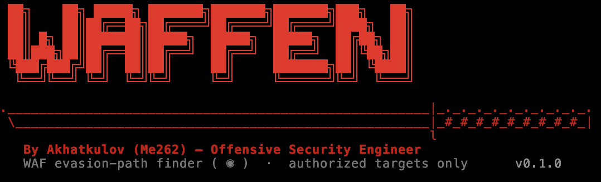

<p align="center">
  
</p>

**The most comprehensive open-source WAF bypass research platform.**

WAFFEN discovers *evasion paths* against Web Application Firewalls: given an
attack payload the WAF blocks, it uses feedback-driven search (beam / genetic /
best-first / MCTS / adaptive pipeline) over 231 mutators × 26 request transforms
to find a mutation chain that bypasses detection — so the coverage gap can be
found and fixed. Built by the RedEye WAF team as a red-team / regression
instrument.

> ⚠️ **Authorized use only.** WAFFEN sends attack-shaped traffic. Point it only at
> systems you own or have written permission to test.

---

## Quick Start

```bash
git clone https://github.com/akhatkulov/WAFFEN.git
cd WAFFEN
python3 -m venv .venv && .venv/bin/pip install -e .
waffen auto                                           # guided wizard
waffen auto --target https://your-waf.example -y      # non-interactive
```

---

## Numbers

| Metric | Count |
|--------|-------|
| Mutators | **231** (incl. SQL-AST, semantic fragmentation, SSTI/SSRF/XXE) |
| Request transforms | **26** (HTTP, multipart, JSON, GraphQL, brotli, H2) |
| Search strategies | **5** (beam, genetic, best-first, MCTS, adaptive) |
| WAF fingerprint signatures | **138** (cloud, on-prem, CDN, regional) |
| Payload corpus | **3002** across 16 attack classes |
| Tests | **1527** |
| Subcommands | **31** |

---

## All Subcommands

### Search & Fuzzing

| Command | Description |
|---------|-------------|
| `bypass` | Guided search for WAF evasion chains (beam/genetic/bestfirst/mcts) |
| `adaptive` | Multi-stage adaptive pipeline: learn → score-probe → gap-scan → search → deepen |
| `fuzz` | High-speed wordlist-driven testing (threaded keep-alive, 500+ req/s, ffuf-style filters) |

### Reconnaissance

| Command | Description |
|---------|-------------|
| `fingerprint` | Identify the WAF (138 signatures: Cloudflare, AWS, Imperva, ModSecurity, etc.) |
| `score-probe` | Map WAF scoring-engine detection thresholds and boundary payloads |
| `libinjection-scan` | Probe for database-specific token blind spots (110+ tokens: SQLite/PG/MySQL/MSSQL) |
| `cve-probe` | Behavioural triage for 2026 WAF engine CVE primitives |
| `discover` | Auto-discover WAF-inspected injection points (params, JSON keys, headers, cookies) |
| `origin` | Find the origin server IP behind a WAF (DNS, MX, SPF, header leaks) |
| `diff` | Differential testing: compare WAF vs origin to diagnose WAF_ONLY / APP_ONLY blocks |
| `calibrate` | Learn WAF block/pass signature; `--cluster` discovers full response taxonomy via k-means |

### Attack Modules

| Command | Description |
|---------|-------------|
| `graphql` | GraphQL attacks: introspection bypass, batch, alias flood, directive injection |
| `ws` | WebSocket attacks: text/binary/fragmented frame injection |
| `sequence` | Multi-request attack sequences (auth→inject, store→trigger, fragment) |
| `oob` | Built-in OOB callback server for blind SSRF/XSS/XXE/RCE verification |

### Workflow

| Command | Description |
|---------|-------------|
| `auto` | Guided wizard — runs the full pipeline automatically with interactive prompts |
| `watch` | Re-test saved bypass findings over time, track what still works vs patched |
| `minimize` | Reduce a 4-step mutation chain to its minimal bypass form |
| `profile` | Show or manage a saved target profile (save/resume across sessions) |

### Defense & Reporting

| Command | Description |
|---------|-------------|
| `defend` | Generate deployable WAF rules from bypasses (ModSecurity, NAXSI, Cloudflare, AWS WAF) |
| `report` | Professional HTML report with executive summary, findings, remediation |
| `eval` | Score WAF coverage + false-positive rate over a corpus (GoTestWAF-style) |

### Analysis & Data

| Command | Description |
|---------|-------------|
| `dataset` | Build a labelled attack+benign training set for WAF ML |
| `analyze` | Analyze a collected log offline (coverage, FP rate, ban heuristic, HTML report) |
| `corpus` | Show the built-in 3000+ payload corpus stats |
| `smuggle` | Experimental timing-based HTTP request-smuggling (CL.TE/TE.CL) probes |

### Utility

| Command | Description |
|---------|-------------|
| `mutators` | List the 231 built-in mutators (filterable by `--class`) |
| `transforms` | List the 26 request-level transforms |
| `kb-update` | Check/apply a knowledge-base update from a configured source |
| `plugin` | Manage community plugins (~/.waffen/plugins/) — list, create, enable, disable |
| `version` | Print version |

---

## Usage Examples

```bash
# Guided wizard (easiest way to start)
waffen auto --target https://your-waf.example --path /search

# Smart bypass search with verification
waffen bypass --target https://your-waf.example \
  --class "SQL Injection" --calibrate --verify --exploit-guided \
  --strategy beam --max-requests 500 --out findings.jsonl

# Adaptive 5-stage pipeline (fully autonomous)
waffen adaptive --target https://your-waf.example --budget 2000 --classes sqli,xss

# High-speed fuzz with 3000+ payloads
waffen fuzz --target https://your-waf.example --param q --corpus sqli -c 50 -mc 200

# Find the real server behind the WAF
waffen origin --domain your-waf.example --verify

# Differential test: is it the WAF or the app blocking?
waffen diff --waf https://waf.example.com --origin https://origin.example.com --class sqli

# Generate ModSecurity rules from bypass findings
waffen defend --findings findings.jsonl --engine modsecurity --out rules.conf

# Professional HTML pentest report
waffen report --findings findings.jsonl --html assessment.html --title "WAF Assessment"

# GitHub Actions CI gate (SARIF → Security tab)
waffen bypass --target $STAGING_URL --class sqli --calibrate --verify --sarif results.sarif

# OOB callback server for blind vulnerability proof
waffen oob --start --port 8888 --external my-vps.com
```

---

## Common Flags

All target-facing subcommands share:

| Flag | Default | Meaning |
|------|---------|---------|
| `--target URL` | — | base URL (also `--url` on `auto`, `--domain` on `origin`) |
| `--path PATH` | `/` | request path |
| `--timeout N` | `15` | per-request timeout (seconds) |
| `--block-signature TEXT` | `"Request blocked by RedEye"` | WAF block page signature |
| `--transport MODE` | `auto` | `auto` / `curl` / `pooled` / `h2` |
| `--header` / `-H` | — | extra request header (repeatable) |
| `--cookie` | — | cookie string for session auth |

---

## Docker

```bash
# One-liner scan:
docker run --rm akhatkulov/waffen bypass --target https://example.com --class sqli --calibrate

# Interactive auto mode:
docker run --rm -it akhatkulov/waffen auto --url https://example.com -y

# Save results to host:
docker run --rm -v $(pwd)/results:/results akhatkulov/waffen bypass \
  --target https://example.com --class sqli --out /results/findings.jsonl

# Build locally:
docker build -t waffen .
```

## Performance

| Mode | Throughput | Use case |
|------|-----------|----------|
| `waffen fuzz` (thread pool) | 500–1000 req/s | Bulk wordlist testing |
| `waffen bypass --concurrency 10` | 200–500 req/s | Parallel search |
| `waffen bypass` (sequential) | 50–200 req/s | Precise search with canary |

Response caching avoids re-sending identical payloads during deep mutation
chains. The pooled transport (default) reuses keep-alive connections.
`--dry-run` shows the request estimate before spending budget.

## Lab Setup

The included lab (`lab/docker-compose.yml`) runs OWASP CRS + ModSecurity in
front of a local Juice Shop for validation testing:

```bash
docker compose -p waffen-lab up -d        # starts on localhost:18080
waffen bypass --target http://localhost:18080 --class "SQL Injection" --calibrate --verify
```

Paranoia levels 1–4 via `PARANOIA=N` env var. See `docs/VALIDATION.md` for
recorded results: 3 verified SQLi bypasses of CRS PL1, zero at PL4.

---

## Further Reading

- **[`docs/VALIDATION.md`](docs/VALIDATION.md)** — real runs against two WAFs (RedEye + CRS lab)
- **[`docs/COMPARISON.md`](docs/COMPARISON.md)** — comparison vs wafw00f / GoTestWAF / sqlmap
- **[`docs/ROADMAP.md`](docs/ROADMAP.md)** — sprint history

## Prior Art

[GoTestWAF](https://github.com/wallarm/gotestwaf),
[wafw00f](https://github.com/EnableSecurity/wafw00f),
[PayloadsAllTheThings](https://github.com/swisskyrepo/PayloadsAllTheThings),
[nuclei-templates](https://github.com/projectdiscovery/nuclei-templates),
[awesome-waf](https://github.com/0xInfection/Awesome-WAF).

## License
MIT.
